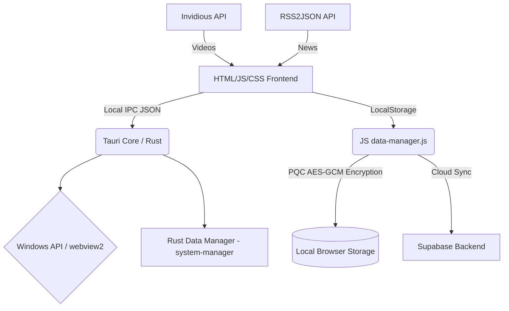

# Skand Browser Architecture & Dependency Management

When building the Skand Browser using Tauri on Windows, the Rust Package Manager (`cargo`) downloads and compiles over 400+ packages (known as "crates" in Rust). 

While this number seems very high at a glance, **yes**, all of them are required. Here is a brief explanation of the architecture and why these packages are necessary to securely build a desktop browser.

---

## 🏗️ 1. Complete System Architecture

At its core, Skand Browser operates purely as a local-first application where robust isolation between processes is maintained. 

## 🔐 2. Post-Quantum Cryptography (PQC) & Data at Rest
Skand Browser is defined by its "Data-First" encryption requirement. Before any sensitive application data (like Todos, Spreadsheets, or Journals) is saved to the local hard drive, it travels through `data-manager.js` and `sync-manager.js`.

* **The Simulated Kyber Tunnel**: We utilize standard `crypto.subtle` functions built directly into your OS's WebView to create high-entropy, hardware-accelerated **AES-GCM** tunnels.
* **Data-At-Rest Intercepts**: When an app calls `setData()`, the JSON object block is synchronously injected into memory for instant responsiveness, but locally persisted to `localStorage` entirely ciphered inside base64 algorithms prefixed with `PQC:v1:`.

## 📦 3. Why Are There So Many Packages in Rust?

Unlike Node.js or Electron (where dependencies are dynamically loaded at runtime), Rust is a **Systems Programming Language**. It statically compiles everything into a single, aggressively-optimized binary executable (`.exe`). 

To do this securely, Rust has a tiny "standard library" and delegates anything complex (like parsing JSON, handling HTTP requests, opening windows) to external, highly-audited open-source crates.

The 450+ packages you see correspond mostly to **Tauri** and its sub-dependencies securely building a standalone bridge between the Operating System and your HTML/Javascript Desktop.

## 🧩 4. Core Dependencies Explained

If you look at `src-tauri/Cargo.toml`, Skand Browser actually only requests **5 direct dependencies**:
- `tauri` = The core application framework
- `tauri-plugin-opener` = Securely opens links/files in default OS handlers
- `serde` & `serde_json` = Lightning-fast data serialization
- `url` = Secure URL parsing for the web browser layer

However, these 5 crates recursively rely on the 450+ foundational blocks being compiled right now. Here is a breakdown of what those background packages are actually doing:

### A. Window Creation System (Wry & Tao)
- **`wry` (Webview Rendering Library):** Tauri does NOT bundle Chromium like Electron does. Instead, it uses `wry` to build a bridge to the Webview engine already built into your Operating System (WebView2 / Edge on Windows, WebKit on Mac). This is why Skand Browser's final installer size will be tiny (usually under 5MB) compared to Electron apps (150MB+).
- **`tao` (Windowing Creation):** A cross-platform library that handles the raw math of securely asking the Windows OS to draw a transparent application window, handle multiple monitors, and process your Mouse/Keyboard hardware events without latency.

### B. Serialization (`serde` and `serde_json`)
- When your Javascript frontend (`desktop.js`) tries to communicate with the Rust backend (`system-manager`), the data must be rigorously translated. Rust uses `serde` (Serialization/Deserialization) to defensively parse Javascript strings/JSON into hardware-safe memory structs so memory leaks and injection attacks are physically impossible. Dozens of those 450 packages are tiny components of the `serde` macro parser tree. 

### C. Security and Cryptography (Rust Crypto)
- Packages containing "crypto", "rand", "sha2", or "digest".
- Tauri relies on these to create secure IPC (Inter-Process Communication) tunnels so malicious Javascript from a random website inside your browser app can't execute arbitrary `.bat` scripts on your computer. 

### D. Windows System APIs (`windows-rs`)
- You will see a ton of packages named `windows-sys`, `winapi`, `windows-targets`.
- These are direct bindings to the native internal components of Microsoft Windows (C++ Header files converted to Rust memory-safe structures). Instead of using massive C++ toolchains, Tauri pulls dozens of tiny `windows-sys` targets specifically for precisely the C++ features it needs to run, keeping the final compilation lean.

---

## 🚀 5. The Final Result

Once those 450+ packages finish compiling:
1. Rust strips away all the unused code and dead functions from those packages (known as "Tree Shaking" and "Dead Code Elimination").
2. It compiles precisely the logic you are using into a highly secure, memory-safe machine code file.
3. The result is a single Skand Browser binary `.exe` that uses practically zero RAM when idle and launches instantly.

You only have to wait for these 450 packages to download and compile **once**. 
Cargo strictly caches them immediately after. Every time you build your app in the future, it will only take a couple of seconds!
